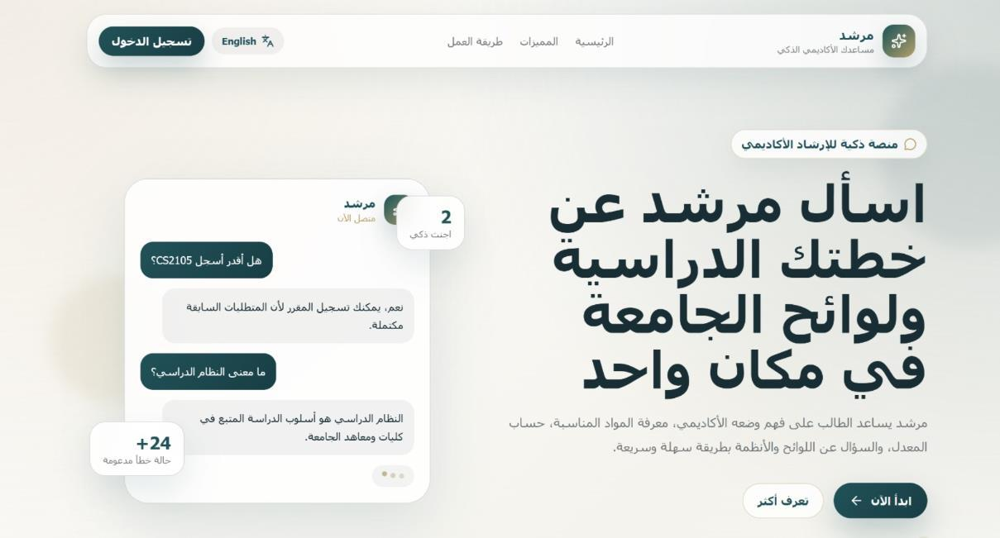
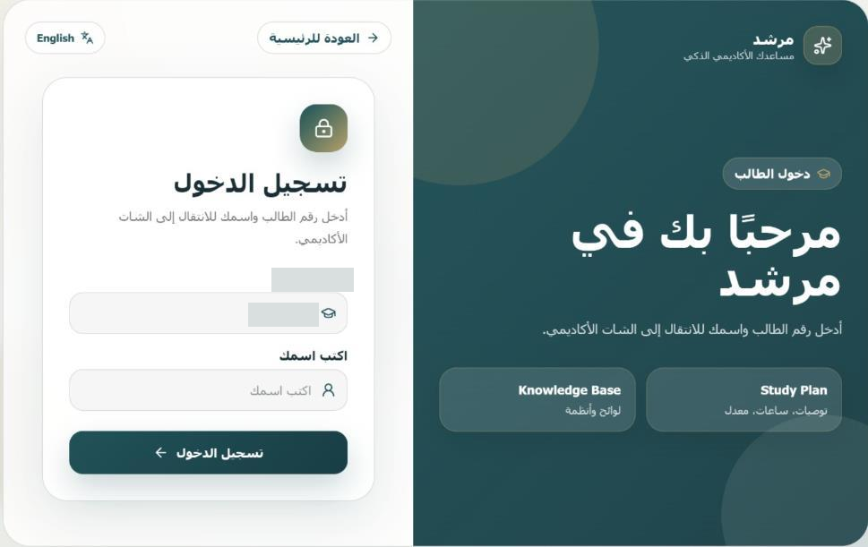
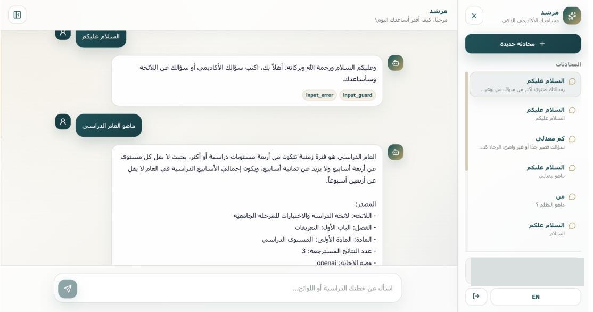

# Murshed — Smart Academic Advisor

Academic planning and university regulations, connected through one conversational interface.

Murshed (Arabic: مرشد) is designed primarily for **Arabic-speaking university students**, with an initial focus on the College of Computing at Umm Al-Qura University. It combines personalized study-plan services with retrieval-augmented answers to academic policy questions.

[Overview](#problem-and-objectives) · [Architecture](#architecture) · [Setup](#installation) · [Evaluation](#evaluation) · [Screenshots](#interface-screenshots) · [Team](#team)

## Problem and objectives

Students often need timely help interpreting study plans, checking prerequisites, understanding regulations, and tracking progress. Routine questions can consume advising time, while scheduled office hours limit access to support.

The graduation report and poster frame Murshed around these objectives:

- Make routine academic guidance accessible beyond scheduled advising hours.
- Connect student questions to their academic records for personalized planning support.
- Provide clear access to registration policies and graduation requirements.
- Automate repetitive advising tasks so advisors can focus on more complex cases.

These are project objectives, not measured claims of reduced workload or continuous production availability. Murshed is an academic prototype that supports advising decisions.

## Features and contributions

| Component | Contribution |
| --- | --- |
| **Study Plan Agent** | Academic snapshots, completed/remaining credits, GPA summaries and simulations, prerequisite checks, and course recommendations using structured student records. |
| **Knowledge Base Agent** | Semantic retrieval of regulation documents and context-grounded answers with source metadata. |
| **Chatbot layer** | Input validation, intent detection, parameter extraction, agent routing, and response formatting. |
| **Student interface** | A web conversation interface with language controls and Firestore-backed conversation history. |

The central contribution is the integration of rule-based academic calculations and regulation retrieval behind one student-facing conversation flow. The report describes synthetic student records for development, alongside course/program information collected from official sources.

## Architecture

<p align="center">
  
</p>

*Approved system architecture in Murshed's teal-and-sage interface palette.*

The system has four main layers: data collection, data processing, specialized agents, and chatbot interaction. The data layers prepare student records, study plans, and academic regulations for the Study Plan Agent and Knowledge Base Agent. The chatbot receives student questions, routes each request to the appropriate agent, and returns the response through the interface.

## Technology stack

Verified against [backend requirements](requirements.txt), [frontend dependencies](Murshed-frontend/package.json), the npm lockfile, and application source.

| Layer | Technologies |
| --- | --- |
| Backend | Python, Flask 3.0.3, Flask-CORS 4.0.1, Firebase Admin SDK 6.5.0 |
| Storage | Cloud Firestore; ChromaDB 0.5.3 |
| RAG and models | LangChain 0.2.11, langchain-chroma 0.1.4, langchain-openai 0.1.20, OpenAI SDK 1.40.0 |
| Dataset processing | pandas 2.2.2, openpyxl 3.1.5 |
| Frontend | React 19, TypeScript 6, Vite 8, React Router 7, Firebase JS SDK 12, Lucide React |

Frontend major versions reflect the declared dependencies; `npm ci` uses the existing lockfile.

## Installation

Use Python 3.11 and Node.js 22.12+ (or 20.19+) with npm on PATH. The Node requirement comes from the locked Vite version. The commands below use Windows PowerShell and start at the repository root.

### Backend environment

```powershell
python -m venv .venv
.\.venv\Scripts\Activate.ps1
python -m pip install -r requirements.txt
```

Create a private root `.env` using credentials supplied through an authorized channel:

```dotenv
OPENAI_API_KEY=<your-own-api-key>
SERVICE_ACCOUNT_PATH=serviceAccountKey.json
```

Place the authorized Firebase Admin key at that path, or point `SERVICE_ACCOUNT_PATH` to its private location. The backend initializes Firestore during import. It requires existing `students`, `courses`, and `programs` records and their academic-record subcollections. Database provisioning/export instructions are not included.

The repository includes the regulation knowledge base (`knowledge_base/data/knowledge_base_dataset_ready.xlsx`, 376 question–answer records) and the Chroma vector store built from it (`knowledge_base/vector_store/`). To rebuild the vector store, delete `knowledge_base/vector_store/` and run `python knowledge_base/scripts/build_vector_store.py`; this requires an OpenAI API key and may slightly change retrieval results.

### Frontend environment

```powershell
cd Murshed-frontend
npm ci
```

Create `Murshed-frontend/.env.local` with privately supplied Firebase web configuration:

```dotenv
VITE_API_BASE_URL=http://127.0.0.1:5000
VITE_FIREBASE_API_KEY=<firebase-web-config>
VITE_FIREBASE_AUTH_DOMAIN=<firebase-web-config>
VITE_FIREBASE_PROJECT_ID=<firebase-web-config>
VITE_FIREBASE_STORAGE_BUCKET=<firebase-web-config>
VITE_FIREBASE_MESSAGING_SENDER_ID=<firebase-web-config>
VITE_FIREBASE_APP_ID=<firebase-web-config>
```

The variable names match [api.ts](Murshed-frontend/src/config/api.ts) and [firebase.ts](Murshed-frontend/src/config/firebase.ts). Vite exposes `VITE_*` values in the browser. Keep OpenAI secrets and Admin credentials exclusively on the backend. The existing `src/config/.env.production` location is not a standard Vite project-root environment-file path.

## Run locally

In a terminal at the repository root, activate the Python environment and start Flask:

```powershell
.\.venv\Scripts\Activate.ps1
python app.py
```

The backend runs at `http://127.0.0.1:5000`. The existing entry point enables debug mode and binds to all interfaces, so use it in a trusted development environment.


In a second terminal at the repository root:

```powershell
cd Murshed-frontend
npm run dev -- --host 127.0.0.1 --port 5173 --strictPort
```

Open `http://127.0.0.1:5173`. Enter an approved demonstration student record and display name through the existing access form. The current Firestore lookup and browser session are a prototype access flow; production use requires a separate authentication, authorization, and Firestore-rules review.

## Evaluation

The [saved results](tests/evaluation_results/evaluation_results.json) are the results reported in the accompanying paper.

| Component | Metric | Result |
| --- | --- | --- |
| Study Plan Agent | Functional checks passed | **100% (15/15)** |
| Knowledge Base Agent | Top-3 retrieval accuracy (self-retrieval) | **97.87% (368/376)** |
| Chatbot Layer | Intent routing accuracy | **96.43% (27/28)** |

[The evaluation script](tests/evaluate_agents.py) checks study-plan responses against [gold cases](tests/evaluation/study_plan_gold.json), tests whether each knowledge-base question retrieves its own record among the top three results, and requires both the agent and intent to match the [routing gold cases](tests/evaluation/chatbot_gold.json).

To reproduce the evaluation, start the backend (`python app.py`) and run `python tests/evaluate_agents.py` in a second terminal. 

These scores describe the saved test sets. Retrieval accuracy does not measure the quality of the generated answers, and the knowledge-base questions are not an independent held-out benchmark.

## Interface screenshots

The following are original application interface. They retain the Arabic interface used by the project's primary audience. Captions and descriptions are in English; opaque privacy redactions remove identifier examples and profile information. 

### Landing page



### Student login



### Chat interface



## Project structure

```text
app.py                       Flask entry point
chatbot/                     Validation, intents, routing, execution, formatting
firebase/                    Firebase Admin initialization
repositories/                Firestore record access
routes/                      HTTP endpoints
services/                    Academic calculations and RAG services
utils/                       Grading, normalization, course graph helpers
knowledge_base/data/         Canonical regulation workbook
knowledge_base/prompts/      Grounded answer prompt
knowledge_base/vector_store/ Preserved Chroma snapshot
Murshed-frontend/            React/TypeScript/Vite interface
tests/evaluation/            Evaluation gold cases
tests/evaluation_results/    Saved JSON results and plots
docs/                        Architecture image and interface screenshots
```

## Team

| # | Team member |
| --- | --- |
| 1 | Jood Mohammed Algarni |
| 2 | Mawaddah Saleem Aloufi |
| 3 | Ruyuf Faisal Almjnooni |
| 4 | Jori Mohammad Bajahnon |

| Role | Name |
| --- | --- |
| Main Supervisor | Dr. Tahani Alqurashi |
| External Supervisor | Dr. Zahyah H. Alharbi |

